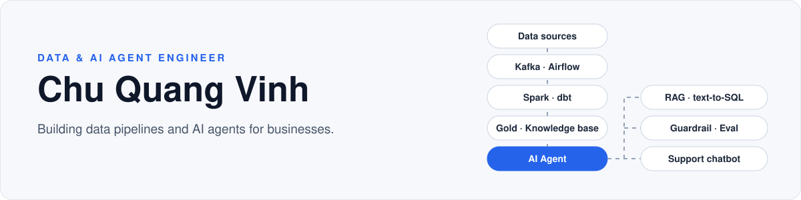

  

<b>English</b> · <a href="README.vi.md">Tiếng Việt</a>

  <code>data pipeline</code>&nbsp;&nbsp;
  <code>lakehouse</code>&nbsp;&nbsp;
  <code>streaming</code>&nbsp;&nbsp;
  <code>RAG</code>&nbsp;&nbsp;
  <code>text-to-SQL agent</code>&nbsp;&nbsp;
  <code>business chatbot</code>

## About

Data Engineer with 2 years of experience, based in Hà Nội. I build data pipelines (Airflow, Kafka, Spark, dbt) and AI agents that answer on top of that data (RAG, text-to-SQL, tool calling).

## 🧪 Personal projects

### [taxi-lakehouse-ai-agent](https://github.com/vinhchuquang/taxi-lakehouse-ai-agent) — ask NYC taxi data in plain Vietnamese

- **Problem:** let people who don't write SQL query the data in natural language, without the agent being able to run a dangerous statement or read outside the allowed data.
- **Approach:** Airflow → MinIO (Bronze) → dbt (Silver → Gold star schema) → DuckDB. FastAPI agent: intent analysis → rule-based planner or LLM-generated SQL → `sqlglot` guardrail (`SELECT` only, cataloged Gold tables only, valid columns and joins) → read-only execution → self-checks → answer with SQL and trace.
- **Results** (`gpt-4.1-mini`, measured 2026-06, reproduction commands in `benchmarks/`):

| Axis | Result |
|---|---|
| Guardrail — 24 attack queries (DML/DDL, injection, non-Gold tables, file reads…) | **24/24 blocked, 0 false positives** |
| Spider dev — 1,034 questions, official evaluator | **EX 81.1%** (GPT-4 zero-shot: 72.3%) |
| 96-question custom set on the taxi domain | **78.1%**, up from 40% through agent improvements |

### [tradewatch](https://github.com/vinhchuquang/tradewatch) — streaming that stays correct when things break

- Live trades from the Binance WebSocket → Kafka (KRaft) → Spark Structured Streaming → Postgres (idempotent sink) + Parquet; public dashboard on Cloudflare Workers + D1.
- The repo is organized around **reproducible experiments** (`make exp-NN`), each answering one question: does a job dying mid-micro-batch lose or duplicate records? Is a record arriving 3 hours late dropped, or does it correct the old result? Does exactly-once come from Spark or from the sink?
- Dirty data is generated by a fault injector (late, duplicate, null, schema drift); design decisions are recorded as ADRs.

### Other

- [realtime_fraud_detection](https://github.com/vinhchuquang/realtime_fraud_detection) — real-time transaction fraud detection: Kafka, Spark Streaming, PostgreSQL, Elasticsearch, Grafana.
- [youtube_analytics](https://github.com/vinhchuquang/youtube_analytics) — YouTube API → Snowflake, dbt Bronze/Silver/Gold models, orchestrated with Airflow (Astro).
- [Prestige DMC](https://prestigevndmc.com) — production travel platform: Express + PostgreSQL backend (82 endpoints, 19 tables), deployed with Docker Compose, GitHub Actions, GHCR, Traefik and Cloudflare Tunnel.

## 🌐 Open-source — [Tencent/WeKnora](https://github.com/Tencent/WeKnora) · ⭐ 30.7k

Tencent's open-source RAG / agent platform. I fix bugs and propose features upstream. As of 2026-09-28: **2 PRs merged, 2 in review, 10 issues**.

| PR | Status | What |
|---|---|---|
| [#3520](https://github.com/Tencent/WeKnora/pull/3520) | ✅ merged | docreader: a base64 payload containing non-ASCII characters failed the whole document parse |
| [#3673](https://github.com/Tencent/WeKnora/pull/3673) | ✅ merged | Restored inner padding on form popups after a style consistency pass ([#3672](https://github.com/Tencent/WeKnora/issues/3672), reported by me) |
| [#3522](https://github.com/Tencent/WeKnora/pull/3522) | 🔍 review | The agent emits the knowledge references it retrieved during a turn, so the UI can show sources |
| [#3187](https://github.com/Tencent/WeKnora/pull/3187) | 🔍 review | Outline datasource connector (collections and nested documents), +2,278 lines |

Notable issues: carry the user's own language into the prompt on IM channels ([#3315](https://github.com/Tencent/WeKnora/issues/3315)), distil recurring questions into reviewed FAQ entries ([#3316](https://github.com/Tencent/WeKnora/issues/3316)).

## 🛠️ Tech stack

- **Data:** Python, SQL, Airflow, dbt, Kafka, Spark, PostgreSQL, Snowflake, DuckDB, AWS S3, Playwright, Scrapy
- **AI / agents:** RAG, text-to-SQL, tool calling, MCP, OpenAI API, n8n
- **Infra:** FastAPI, Docker, Jenkins, GitHub Actions, Traefik, Grafana

## 🎓 Education

**HUST** — Mathematics & Informatics, 2022 – present

## 📫 Contact

- Email: chuquangvinh.work@gmail.com
- LinkedIn: [linkedin.com/in/chu-vinh](https://www.linkedin.com/in/chu-vinh)
