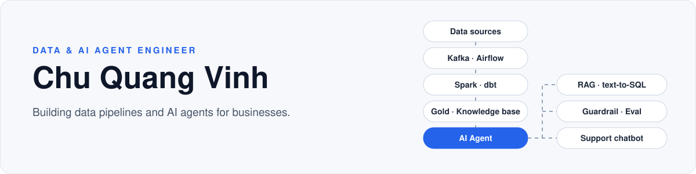

  

<a href="README.md">English</a> · <b>Tiếng Việt</b>

  <code>data pipeline</code>&nbsp;&nbsp;
  <code>lakehouse</code>&nbsp;&nbsp;
  <code>streaming</code>&nbsp;&nbsp;
  <code>RAG</code>&nbsp;&nbsp;
  <code>text-to-SQL agent</code>&nbsp;&nbsp;
  <code>chatbot doanh nghiệp</code>

## Giới thiệu

Tôi làm data engineering và AI agent: xây pipeline dữ liệu (Kafka, Spark, dbt, Airflow) và agent trả lời trên dữ liệu đó (RAG, text-to-SQL, tool calling).

## 💼 Dự án thực tế — Chatbot CSKH trên [comacpro.net](https://comacpro.net)

Chatbot trả lời khách hàng trên website của một doanh nghiệp thiết bị xây dựng, hỗ trợ nhiều ngôn ngữ và trả lời dựa trên tài liệu sản phẩm.

👉 **Thử tại [comacpro.net](https://comacpro.net)** — nút chat ở góc màn hình. Chi tiết kỹ thuật thuộc công ty nên không public.

## 🧪 Dự án cá nhân

### [taxi-lakehouse-ai-agent](https://github.com/vinhchuquang/taxi-lakehouse-ai-agent) — hỏi dữ liệu taxi NYC bằng tiếng Việt

- **Vấn đề:** cho người không biết SQL hỏi dữ liệu bằng ngôn ngữ tự nhiên, mà agent không thể chạy lệnh nguy hiểm hay đọc ngoài vùng dữ liệu được phép.
- **Cách làm:** Airflow → MinIO (Bronze) → dbt (Silver → Gold star schema) → DuckDB. Agent FastAPI: phân tích intent → planner luật hoặc LLM sinh SQL → guardrail `sqlglot` (chỉ `SELECT`, chỉ bảng Gold trong catalog, cột và join hợp lệ) → thực thi read-only → self-check → trả lời kèm SQL và trace.
- **Kết quả** (`gpt-4.1-mini`, đo 2026-06, lệnh tái tạo nằm trong `benchmarks/`):

| Trục | Kết quả |
|---|---|
| Guardrail — 24 truy vấn tấn công (DML/DDL, injection, bảng ngoài Gold, đọc file…) | **chặn 24/24, 0 chặn nhầm** |
| Spider dev — 1.034 câu, evaluator chính thức | **EX 81,1%** (GPT-4 zero-shot: 72,3%) |
| Bộ 96 câu tự xây trên domain taxi | **78,1%**, tăng từ 40% nhờ các cải tiến agent |

### [tradewatch](https://github.com/vinhchuquang/tradewatch) — streaming đúng cả khi hệ thống hỏng

- Trade thật từ Binance WebSocket → Kafka (KRaft) → Spark Structured Streaming → Postgres (sink idempotent) + Parquet; dashboard công khai trên Cloudflare Workers + D1.
- Repo tổ chức quanh **thí nghiệm tái lập được** (`make exp-NN`), mỗi thí nghiệm trả lời một câu hỏi: job chết giữa micro-batch thì mất hay nhân đôi record? Record trễ 3 giờ bị drop hay sửa kết quả cũ? Exactly-once đến từ Spark hay từ sink?
- Dữ liệu bẩn tự tạo bằng fault injector (trễ, trùng, null, schema drift); quyết định thiết kế ghi thành ADR.

### Khác

- [realtime_fraud_detection](https://github.com/vinhchuquang/realtime_fraud_detection) — phát hiện gian lận giao dịch realtime: Kafka, Spark Streaming, PostgreSQL, Elasticsearch, Grafana.
- [youtube_analytics](https://github.com/vinhchuquang/youtube_analytics) — YouTube API → Snowflake, mô hình dbt Bronze/Silver/Gold, điều phối bằng Airflow (Astro).

## 🌐 Đóng góp open-source — [Tencent/WeKnora](https://github.com/Tencent/WeKnora) · ⭐ 29.6k

Nền tảng RAG / agent mã nguồn mở của Tencent. Tôi sửa lỗi và đề xuất tính năng rồi gửi lại upstream. Tính đến 2026-09-24: **2 PR đã merge, 2 PR đang review, 10 issue**.

| PR | Trạng thái | Nội dung |
|---|---|---|
| [#3520](https://github.com/Tencent/WeKnora/pull/3520) | ✅ merged | docreader: một payload base64 chứa ký tự non-ASCII làm hỏng cả lượt parse tài liệu |
| [#3673](https://github.com/Tencent/WeKnora/pull/3673) | ✅ merged | Khôi phục padding cho các popup form sau đợt đồng bộ style ([#3672](https://github.com/Tencent/WeKnora/issues/3672), tôi tự báo) |
| [#3522](https://github.com/Tencent/WeKnora/pull/3522) | 🔍 review | Agent trả về các tài liệu tham chiếu đã truy xuất trong lượt trả lời, để giao diện hiện được nguồn |
| [#3187](https://github.com/Tencent/WeKnora/pull/3187) | 🔍 review | Connector nguồn dữ liệu Outline (collection và tài liệu lồng nhau), +2.278 dòng |

Issue đáng chú ý: đưa ngôn ngữ của người dùng vào prompt trên kênh IM ([#3315](https://github.com/Tencent/WeKnora/issues/3315)), gom câu hỏi lặp lại thành FAQ có duyệt ([#3316](https://github.com/Tencent/WeKnora/issues/3316)).

## 🛠️ Tech stack

- **Dữ liệu:** Python, SQL, Kafka, Spark Structured Streaming, dbt, Airflow, DuckDB, PostgreSQL, Snowflake, MinIO, Elasticsearch
- **AI / agent:** RAG, text-to-SQL, tool calling, MCP, guardrail `sqlglot`, benchmark (Spider), OpenAI API
- **Ứng dụng & hạ tầng:** FastAPI, Go, Vue, Docker, Cloudflare Workers + D1, GitHub Actions

## 📫 Liên hệ

- Email: chuquangvinh.work@gmail.com
